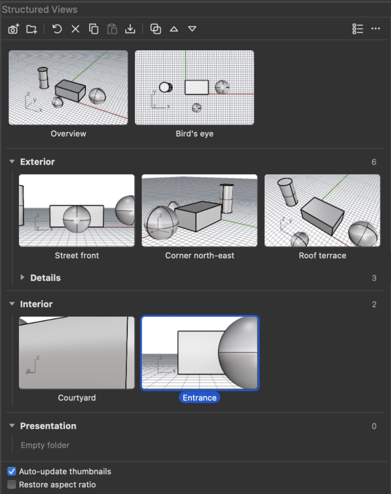
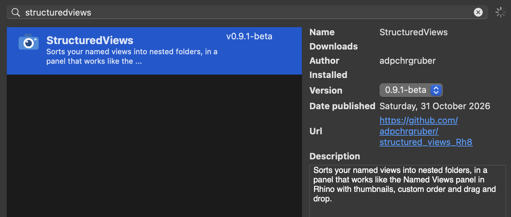

# Structured Views



Rhino's Named Views panel, with folders.

Structured Views is a Rhino 8 plug-in (Mac and Windows). Its panel does everything the Named Views panel
does: save, restore, update, rename, duplicate, delete, properties, copy and paste, import from a .3dm, list
and thumbnail modes, sorting and animation settings. It also lets you sort views into nested folders.

The views stay ordinary Rhino named views. The `NamedView` command, layouts, render queues and colleagues
without the plug-in still see every view. The folders are extra information stored in the .3dm.

> Made with generative AI assistance — see [Credits and AI disclosure](#credits-and-ai-disclosure).

<br clear="right">

## Installation

Requires Rhino 8 on Mac or Windows. Tested on macOS (light and dark mode) and Windows.

### Step by step, with the Package Manager

1. **Open the Package Manager.** In Rhino, type this command and press Enter:

   ```
   PackageManager
   ```

   or use the menu: *Tools › Package Manager…* (Mac), *Tools › Package Manager* (Windows).

2. **Turn on pre-releases.** Tick **Include pre-releases** at the bottom left of the window.
   Structured Views is a beta (`0.9.1-beta`), and beta versions are hidden without this box.

3. **Find it.** On the **Online** tab, type `StructuredViews` into the search field.

4. **Install.** Select *StructuredViews* (the blue camera) and click **Install**.

   

5. **Restart Rhino.** Quit Rhino completely and open it again; the plug-in loads at start-up.

6. **Open the panel.** Type this command and press Enter:

   ```
   StructuredViews
   ```

   The Structured Views panel opens. Drag its tab into the side bar to dock it next to your other
   panels; Rhino remembers the place.

7. **Get started.** Click the camera button to save the current viewport as a named view, and the
   folder button to create a folder. Views you already have appear at the top, ready to drag into
   folders.

**Updates** arrive through the Package Manager. Keep *Include pre-releases* ticked, and either let
*Automatically update packages when Rhino starts* do it, or select StructuredViews on the
**Installed** tab and pick the new version. **To uninstall**, select it on the **Installed** tab and
click **Uninstall**, then restart Rhino. Your folders stay in your files, and your named views are
untouched.

### Other ways to install

- **From the package file:** download
  [`dist/structuredviews-0.9.1-beta-rh8_0-any.yak`](dist/) and drag it into a Rhino window. Restart
  Rhino.
- **From the command line** (Rhino closed), with this repository checked out:

  Mac (Terminal):

  ```sh
  "/Applications/Rhino 8.app/Contents/Resources/bin/yak" install --source ./dist StructuredViews 0.9.1-beta
  ```

  Windows (Command Prompt):

  ```bat
  "C:\Program Files\Rhino 8\System\Yak.exe" install --source .\dist StructuredViews 0.9.1-beta
  ```

  Or straight from the package server, from any folder:

  ```sh
  "/Applications/Rhino 8.app/Contents/Resources/bin/yak" install StructuredViews 0.9.1-beta
  ```

  Giving the version number makes sure yak installs this beta.

## Layout

The panel is a sectioned gallery rather than a tree:

- Top-level views come first, as a thumbnail grid without a heading.
- Every folder is a full-width header: a chevron, the folder name in bold and the number of views inside it.
  Its views flow underneath in the same evenly spaced grid, followed by its subfolders.
- Nesting is shown by indenting the header and its contents and by a thin guide line, so thumbnails stay
  in clean columns instead of stepping sideways with every level.
- List mode uses the same sections with compact rows.

## Using it

Run `StructuredViews` to open the panel.

The toolbar follows Rhino's Named Views panel: **Save**, **New Folder** | **Restore**, **Delete**,
**Copy**, **Paste**, **Import** | **Duplicate**, **Move Up**, **Move Down**, then on the right the
thumbnail/list switch and an options menu (View Mode, Sort By, Animate Restore, Animation Settings,
Refresh Thumbnails, Expand/Collapse All Folders). Below the views, as in Rhino's panel, are
**Auto-update thumbnails** and **Restore aspect ratio**. On a narrow panel the toolbar wraps onto a
second row instead of hiding buttons.

| Action | How |
|---|---|
| Save the current viewport | Camera button. The view goes into the selected folder |
| New folder | Folder button. It is created inside the selected folder |
| Restore | Double-click, Return, the restore button, or right-click › Restore › To Current Viewport / To New Floating Viewport |
| Update to the current viewport | Right-click › Update to Current Viewport |
| Rename | Right-click › Rename…, or F2 |
| Duplicate | Duplicate button, right-click › Duplicate, or ⌘D / Ctrl+D |
| Delete | ✕ button, Delete or Backspace. A deleted folder's contents move up one level |
| Properties (name, camera, target, lens) | Right-click › Properties… |
| Copy and paste, also between open files | Toolbar, right-click, or ⌘C / ⌘V (Ctrl on Windows) |
| Move into a folder | Drag onto a folder header, or right-click › Move to Folder |
| Reorder (Custom Order) | Drag between thumbnails, or Move Up / Move Down. Drag onto the top or bottom edge of a folder header to put a folder before or after it |
| Copy by dragging | Hold Option (Alt) while dragging |
| Collapse or expand a folder | Click its chevron, double-click its header, or use ← / → |
| Select several | ⌘ or Ctrl click, Shift click, ⌘A / Ctrl+A |
| Import from a .3dm | Import button. Views go into a new folder named after the file, and the file's own folders are kept |

## How it works

- **Folders** are stored in the document's string table, section `StructuredViews`:
  `f:<folder id>` = `parent|order|name` and `v:<named view id>` = `folder|order`.
  Views are matched by `ViewInfo.NamedViewId`, which stays the same when a view is renamed, updated or saved.
  A view without an entry (for example one saved with Rhino's own panel) sits at the end of the top level.
- **Thumbnails** are captured by the plug-in, because Rhino doesn't expose the ones from its own panel.
  - A view is captured from the active viewport when you save or update it.
  - Any view without a thumbnail, or with an outdated one after the model changed, is captured on idle.
    The plug-in borrows a viewport for one capture and puts its camera, target, CPlane, title, display mode
    and wallpaper back before anything is redrawn.
  - Thumbnails are saved in the .3dm as plug-in data.

## Not included

These parts of Rhino's Named Views panel are not part of Structured Views:

- the named view widget,
- Edit by Looking,
- dragging a view onto a viewport or into another file's panel (use copy and paste instead).

## Building

```
dotnet build -c Release
```

This builds `bin/Release/net7.0/StructuredViews.rhp` (Mac and Windows) and `net48` (Windows), and
packs `dist/structuredviews-<version>-rh8_0-any.yak`. Icons are generated with `python3 tools/make_icon.py`.

Rhino can't unload a plug-in: restart Rhino after rebuilding to pick up changes. Never copy a new build
over a loaded `.rhp`; raise `<Version>` and install the new package instead.

To publish a new version to the Rhino Package Manager:

```sh
yak login
yak push dist/structuredviews-<version>-rh8_0-any.yak
```

A published version can't be replaced, only hidden with `yak yank`; raise `<Version>` for every release.

## Credits and AI disclosure

Structured Views was co-created by **adpchrgruber** and generative AI.

**Use of generative AI.** The plug-in was developed in conversation with *Claude Opus 5.5*
(Anthropic), working as a coding agent in *Claude Code*, in October 2026. The AI:

- wrote the source code: the folder store in the document's string table
  (`src/Model/FolderStore.cs`), the view structure and all named-view operations
  (`src/Model/Structure.cs`, `src/Model/ViewOps.cs`), thumbnail capture
  (`src/Model/Thumbnails.cs`), the settings, the hand-drawn gallery
  (`src/UI/ViewCanvas.cs`), the toolbar and line icons (`src/UI/Icons.cs`), the dialogs
  (`src/UI/Dialogs.cs`), the panel (`src/UI/StructuredViewsPanel.cs`), the plug-in and
  command classes, the build and packaging setup and the icon generator
  (`tools/make_icon.py`);
- researched the RhinoCommon and Eto APIs, and found and worked around several Rhino and
  Eto behaviours on the Mac (viewport camera restore, table-backed `ViewInfo`, context
  menus, drag and drop, mouse capture, double-click delivery);
- tested the plug-in in Rhino 8 on macOS, including the user interface, saving and
  reopening files;
- drafted this README.

**Human contribution.** adpchrgruber conceived the plug-in (Rhino's Named Views panel with
folders), named it, set the brief (copy the native panel, design a better folder layout,
clean and robust code), chose the blue camera icon, made the design decisions, tested it in
Rhino, reviewed the results and publishes it. The author takes responsibility for the
published plug-in.

**No AI-generated imagery.** The icons are drawn by code (`tools/make_icon.py` and vector
paths in `src/UI/Icons.cs`). The thumbnails are captured from the user's own Rhino
viewports, and the screenshot in this README is a capture of the panel in Rhino. No image
was made by a generative AI model.

**Citing the AI tools.** APA 7:

> Anthropic. (2026). *Claude* (Opus 5.5 version) [Large language model].
> https://www.anthropic.com/claude
>
> Anthropic. (2026). *Claude Code* [Computer software]. https://claude.com/claude-code

Chicago (note):

> 1. Code and text generated by Claude Opus 5.5, Anthropic, via Claude Code, October 2026,
> https://claude.com/claude-code; prompted and reviewed by adpchrgruber.

**Citing Structured Views.** See [`CITATION.cff`](CITATION.cff), or *Cite this repository*
on the GitHub page.

**Software and acknowledgements.**

- [Rhinoceros 8](https://www.rhino3d.com/) and
  [RhinoCommon](https://developer.rhino3d.com/api/rhinocommon/) by Robert McNeel &
  Associates. The panel follows the layout and features of Rhino's own Named Views panel;
  the views remain Rhino named views.
- [Eto.Forms](https://github.com/picoe/Eto) by Curtis Wensley and contributors, the
  cross-platform UI framework Rhino ships with.
- [Yak](https://developer.rhino3d.com/guides/yak/), the Rhino package manager, for packaging.
- Project structure and packaging follow [ClownID](https://github.com/adpchrgruber/ClownID_Rh8).

## Licence

MIT, see [LICENSE](LICENSE).
